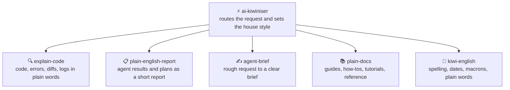

```
 █████╗ ██╗
██╔══██╗██║
███████║██║
██╔══██║██║
██║  ██║██║
╚═╝  ╚═╝╚═╝
██╗  ██╗██╗██╗    ██╗██╗███╗   ██╗██╗███████╗███████╗██████╗
██║ ██╔╝██║██║    ██║██║████╗  ██║██║██╔════╝██╔════╝██╔══██╗
█████╔╝ ██║██║ █╗ ██║██║██╔██╗ ██║██║███████╗█████╗  ██████╔╝
██╔═██╗ ██║██║███╗██║██║██║╚██╗██║██║╚════██║██╔══╝  ██╔══██╗
██║  ██╗██║╚███╔███╔╝██║██║ ╚████║██║███████║███████╗██║  ██║
╚═╝  ╚═╝╚═╝ ╚══╝╚══╝ ╚═╝╚═╝  ╚═══╝╚═╝╚══════╝╚══════╝╚═╝  ╚═╝
```

<div align="center">

# ⚡ AI Kiwiniser

**Agent skills that turn coding and agent talk into plain New Zealand English, and rough requests into clear briefs for an agent.**

[](https://github.com/KinwiseNZ-DevOps/ai-kiwiniser/actions/workflows/validate.yml)
[](LICENSE)
[](https://agentskills.io)
[](https://agentskills.io/specification)
[](scripts/skills_tool.py)

</div>

Table of contents:

- [Skills](#skills)
- [How they fit together](#how-they-fit-together)
- [Install](#install)
- [Usage](#usage)
- [Validate](#validate)
- [Layout](#layout)
- [Status and limits](#status-and-limits)

---

> [!IMPORTANT]
> **Principle: keep the facts exactly as the code or agent produced them, and make the words around them plain enough for the reader to act on.**

Coding agents and code are written for experts. These skills write for a bright 16-year-old with no coding background, so the idea, the context and the next step make sense on one read, without anyone working out what a word means. They help everyone else understand them: what a piece of code, an error or a change means, what an agent really did and did not check, and how to ask an agent for what you actually want. They use the plain-language tests in New Zealand's Plain Language Act 2022 (right for the audience, clear, concise, well organised), widely used plain-writing guidance, and New Zealand English conventions. They follow the open [Agent Skills](https://agentskills.io/specification) format and work in Claude Code, Codex, Cursor, Copilot, OpenCode or any SKILL.md-compatible agent.

---

<a id="skills"></a>
## 🧩 Skills

<!-- catalogue:begin -->
| Skill | Purpose |
|---|---|
| [`agent-brief`](skills/agent-brief/SKILL.md) | Turns a person's rough request into a clear brief an AI agent can act on: the goal in their words, the context, constraints, what done looks like and what to leave alone, asking at most one question when the answer would change the work. |
| [`ai-kiwiniser`](skills/ai-kiwiniser/SKILL.md) | Router and shared house style for turning coding and agent output into plain New Zealand English that a non-expert can follow, and rough human requests into clear briefs for an agent. |
| [`explain-code`](skills/explain-code/SKILL.md) | Explains code, diffs, error messages, stack traces, logs, config and commands in plain New Zealand English for a reader with no coding background: what it does, why it matters, what could go wrong, and the next step. |
| [`kiwi-english`](skills/kiwi-english/SKILL.md) | Applies plain-language writing and New Zealand English conventions to text: everyday word choice, short sentences, spelling, dates, numbers, currency, te reo Māori words and macrons, and acronym handling. |
| [`plain-docs`](skills/plain-docs/SKILL.md) | Writes software documentation in plain New Zealand English that a bright 16-year-old can follow: it picks the right form (tutorial, how-to, reference or explanation), fixes the audience, goal and scope, agrees an outline, then writes and checks every claim against the real code. |
| [`plain-english-report`](skills/plain-english-report/SKILL.md) | Turns an agent's plan, results, test run, status, commit message or pull request description into a short plain New Zealand English report: what happened, what it means, what the reader must decide, and what was not checked. |
<!-- catalogue:end -->

---

<a id="how-they-fit-together"></a>
## 🗺️ How they fit together



Start at the router. The other five skills share its house style, and `kiwi-english` is the final check on any text.

---

<a id="install"></a>
## 📦 Install

> [!TIP]
> Install the router skill **plus every sibling skill it links to**; routers reference siblings by relative path.

**Claude Code plugin** (installs the skills together):

```text
/plugin marketplace add KinwiseNZ-DevOps/ai-kiwiniser
/plugin install ai-kiwiniser@ai-kiwiniser-marketplace
```

Or copy or symlink the `skills/` subfolders you want into your agent's skills directory:

| Agent | Where skills live |
|---|---|
| Claude Code | `~/.claude/skills/` or a project's `.claude/skills/` |
| Codex · Cursor · Copilot · OpenCode · Windsurf | the agent's own SKILL.md discovery path |

---

### Always on

In Claude Code, AI Kiwiniser loads a short ruleset into every session as soon as the plugin is installed (plain words for a 16-year-old reader, 200 words at most, one step at a time, no claims without evidence). It tells you its state at the start of each session and costs roughly 450 tokens.

| Mode | What it does |
|---|---|
| `on` (default) | The rules apply in every session |
| `auto` | The rules apply only in projects that look relevant: not applicable; the style is useful everywhere, so `auto` behaves like `on` |
| `off` | The rules do not load |

- Say **"stop kiwi mode"** to pause it for the current session, and **"start kiwi mode"** to resume.
- Ask Claude to **set the saved mode to on, off or auto**. It writes that word into `~/.claude/.ai-kiwiniser.mode`. You can also edit that file yourself, and deleting it returns to the default (`on`).
- It needs Node on the machine, because the start-up hook runs a small Node script. Without Node the hook quietly does nothing.
- Other agents have no start-up hook here. Paste `skills/ai-kiwiniser/references/always-on-rules.md` into that agent's instruction file instead.

### Safety checks

The same hooks run a few checks while you work. Each one only asks, warns or adds a reminder; none changes your files on its own.

| Check | What it does | On by default |
|---|---|---|
| `dangerGuard` | Asks before risky commands: force pushes, `git reset --hard`, `rm -r`, dropping data, `docker compose down -v`, publishing a package | Yes |
| `secretsGuard` | Asks before writing keys, tokens or `.env` files | Yes |
| `packageGuard` | Asks if a package about to be installed does not exist on PyPI, npm or pub.dev, because the name may be invented | Yes |
| `licenseGuard` | Warns after installing an npm or PyPI package with a GPL-family licence | Yes |
| `editSecurity` | Reminds Claude about risky code it just wrote: `eval`, SQL built from strings, unescaped HTML, tokens in SharedPreferences | Yes |
| `promptGuard` | Warns when pasted text looks like it is trying to steer the agent | Yes |
| `verifyReminder` | Tells you at the end of a turn if code changed but no tests, lint or analysis ran | Yes |
| `linkGuard` | Warns about links that return "not found" in Markdown, HTML and JSX files written | Yes |
| `styleGuard` | Warns when a reply is over 200 words or uses an em or en dash (built for AI Kiwiniser's style) | Yes |
| `sessionLog` | Writes tool names and file names, never content, to `~/.claude/logs/ai-kiwiniser/` | No |
| `autoCommit` | Saves tracked changes as a local commit at the end of a turn. It never pushes | No |

Switch any check with `~/.claude/.ai-kiwiniser.features.json`, for example `{"packageGuard": false, "sessionLog": true}`, or ask Claude to write it. The saved mode (on, off or auto) applies to every check. If several of these plugins are installed, each risky action is checked once, not once per plugin.

Privacy: `packageGuard` and `licenseGuard` send package names, and `linkGuard` sends the links it checks, to the public registry or site. Nothing else leaves your machine. Turn those checks off if that is a concern.

<a id="usage"></a>
## 🚀 Usage

> [!TIP]
> **You never need to memorise skill names.** Describe what you want in plain words; the router picks the right skill. If you want short phrases that always work, use these:

**The flow** (this is all most people need):

```text
1. "What does this do?"            → a plain explanation of the code, with the risks
2. "Explain what the agent did"    → a short report: result, checked, not checked, your decision
3. "Help me ask the agent for X"   → a clear brief you can send, with assumptions labelled
```

**Short phrases that trigger each skill:**

| Just say… | What you get | Skill used |
|---|---|---|
| `What does this error mean?` | Meaning, likely cause, first thing to try | *explain-code* |
| `Explain this change` | What it does, what could go wrong | *explain-code* |
| `Summarise what you just did` | Outcome, what was checked, what to decide | *plain-english-report* |
| `Write a commit message` | A short plain message that says why | *plain-english-report* |
| `Turn this into instructions for an agent` | A brief with goal, limits and done-when | *agent-brief* |
| `Write a how-to for this` | The right kind of document, outlined first, checked against the code | *plain-docs* |
| `Make this plain NZ English` | Simpler wording, NZ spelling, dates and macrons | *kiwi-english* |

> [!NOTE]
> Skills also trigger on their own when your request matches. In Claude Code you can also invoke one explicitly with `/ai-kiwiniser`, but the plain phrases above are shorter and work across every agent.

---

<a id="validate"></a>
## ✅ Validate

```bash
python scripts/skills_tool.py check
```

Checks: frontmatter, name/folder match, description length and trigger, body under 500 lines, every relative link resolves (including README.md and AGENTS.md), agent profile naming with no more than two profiles per host and exactly one `-workflow` main agent, agent `skills:` entries that exist and no `skills/<name>/SKILL.md` paths in agent bodies, plugin manifests (`.claude-plugin/plugin.json` and `marketplace.json`: required fields, licence matches `LICENSE`, `agents` lists every Claude Code profile, no top-level `agents/` folder), at least 3 eval cases per skill, catalogue freshness, no project-specific terms from `reference-content/strip-terms.txt`, and no em or en dashes in file names or in any text outside `reference-content/`. It also rejects leftover placeholders and setup-only paths that are tracked by Git or not ignored. Stdlib only, no dependencies.

---

<a id="layout"></a>
## 🗂️ Layout

<details>
<summary>Repository layout</summary>

```
skills/<name>/SKILL.md      one folder per skill (+ references/ where needed)
.claude-plugin/             plugin.json and marketplace.json (Claude Code plugin)
hooks/                      always-on rules and safety checks for Claude Code
evals/cases.jsonl           3+ behavioural cases per skill
resources/agents/           optional host profiles copied by installer
scripts/install_agents.py   copy optional agent profiles into a project
scripts/skills_tool.py      validate, regenerate catalogue (stdlib only)
.github/workflows/          CI runs `skills_tool.py check` (free on public repos)
AGENTS.md                   agent-facing rules for this repo
```

</details>

---

<a id="status-and-limits"></a>
## 📌 Status and limits

> [!NOTE]
> - These skills translate and explain; they do not write or change code. Use the coding skills (for example `flutter-developer` and `django-api-architect`) for that.
> - Several New Zealand conventions rest on secondary style guides because some official pages could not be fetched. The skill references say which, so check your own organisation's guide.
> - Macron and te reo guidance follows the Māori Language Commission's approach as summarised by secondary sources; check Te Aka Māori Dictionary for spelling.
> - No agent profiles are supplied; the skills run directly in any compatible agent.
> - Licensed under MIT (see [LICENSE](LICENSE)).

---

<div align="center">

**⚡ Built on the [Agent Skills](https://agentskills.io) open format · grounded in the [Plain Language Act 2022](https://www.legislation.govt.nz/act/public/2022/0054/latest/whole.html) and [plain-language guidance](https://digital.gov/guides/plain-language)**

</div>
